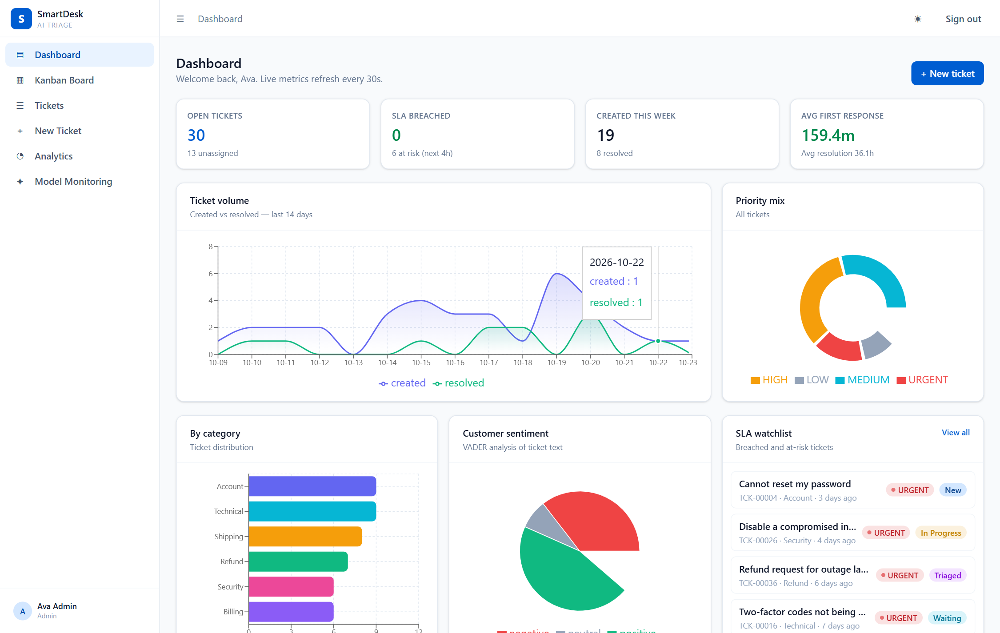
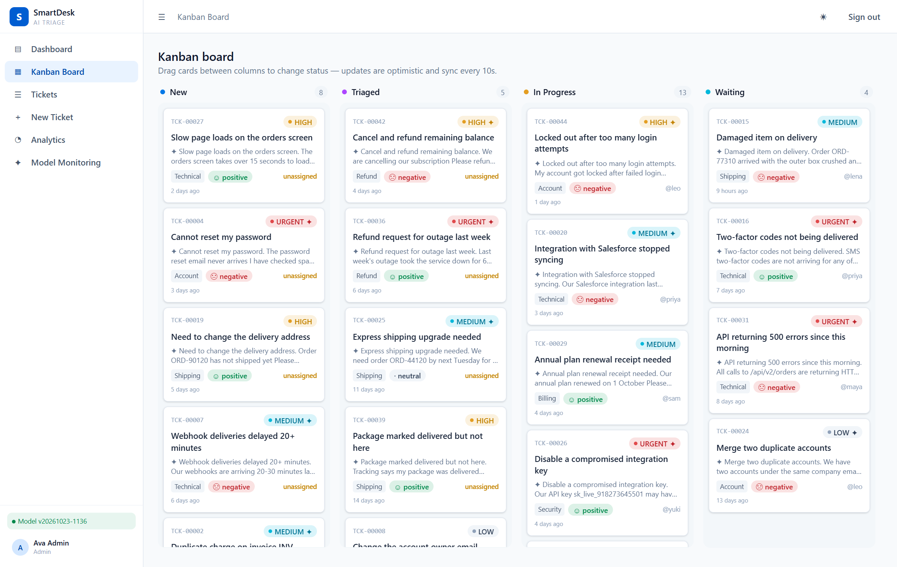
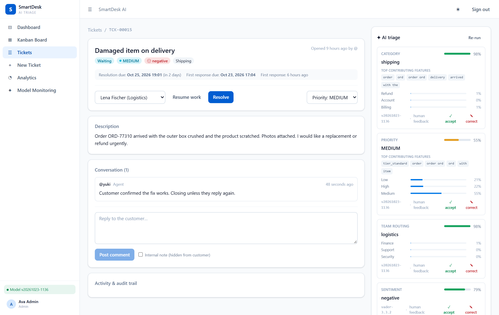
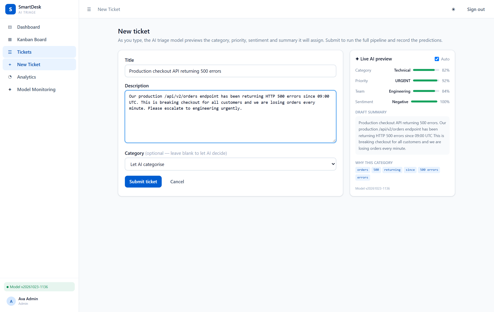
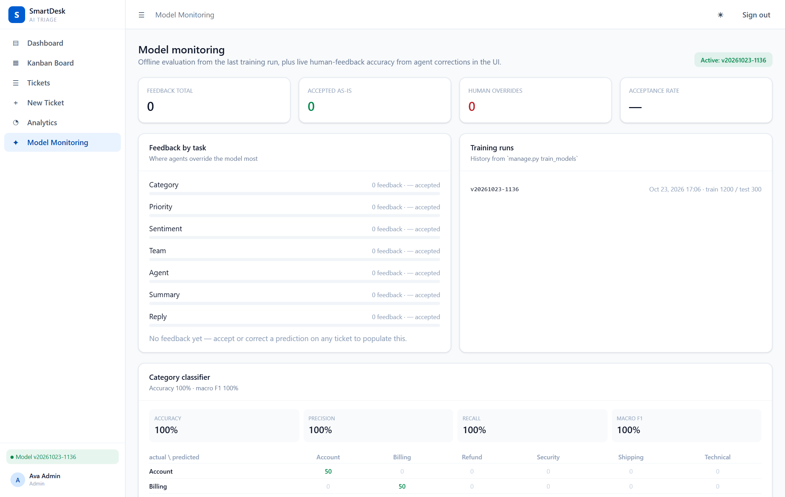
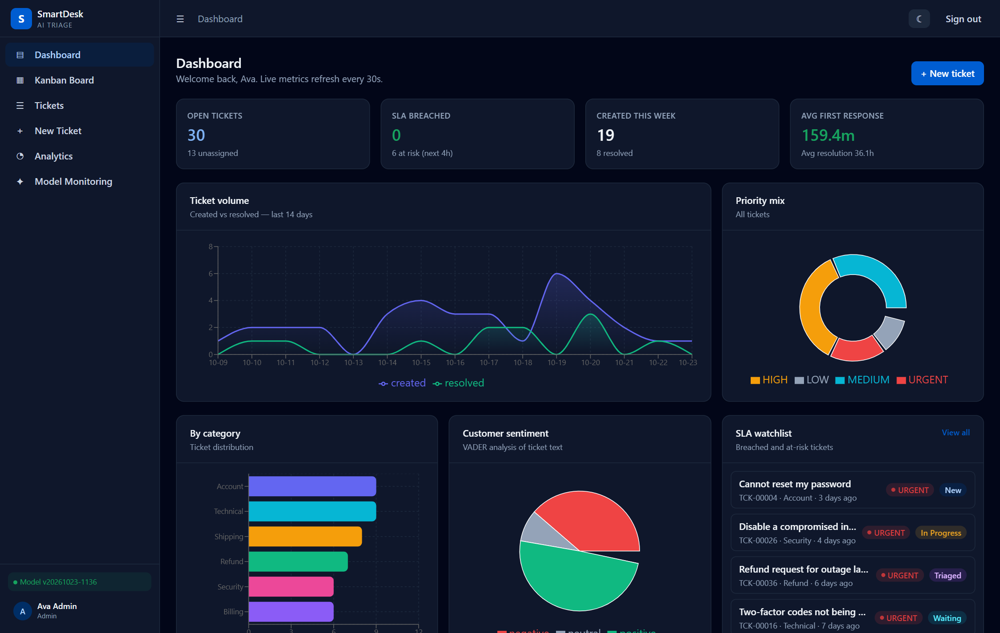

# SmartDesk AI

**Explainable AI ticket triage & operations management** — a production-style helpdesk platform where
ML classifies, prioritises, routes and summarises support tickets, and every human override becomes
training signal.

> React + TypeScript + Vite · Django REST Framework · scikit-learn · PostgreSQL · Docker

---

## Problem statement

Support teams drown in manual triage. Tickets arrive unlabelled, urgency is guessed, and the wrong
queue burns SLA budget. SmartDesk AI automates the first pass — categorisation, priority, team
routing, sentiment, summary and a retrieval-based reply draft — while keeping a human firmly in
control: agents accept or correct every prediction, and those corrections are tracked as model
monitoring metrics.

**Positioned as decision-support, not agent replacement.** Every AI output carries a confidence
score, the top contributing features, and a one-click accept/correct flow that writes to an audit
trail.

## Architecture

```
┌────────────────────┐     REST + JWT      ┌──────────────────────────┐
│  React (Vite)      │◄───────────────────►│  Django REST Framework   │
│  TanStack Query    │   polls 10–30s      │  SimpleJWT auth + RBAC   │
│  Zustand · dnd-kit │                     │  filters · audit trail   │
│  Recharts · TW4    │                     └────────────┬─────────────┘
└────────────────────┘                                  │
                                            ┌───────────┴───────────┐
                                            │       PostgreSQL      │
                                            │   (SQLite for local)  │
                                            └───────────┬───────────┘
                                                        │ joblib artifacts
                                            ┌───────────▼───────────┐
                                            │   ML inference layer  │
                                            │  TF-IDF + LogReg ×3   │
                                            │  VADER sentiment      │
                                            │  cosine retrieval     │
                                            └───────────▲───────────┘
                                                        │ train.py
                                            ┌───────────┴───────────┐
                                            │  ml/ training pipeline │
                                            │  corpus · eval · report│
                                            └───────────────────────┘
```

## The ML loop

| Task | Method | Explainability |
| --- | --- | --- |
| Category (6 classes) | TF-IDF (1–2 grams) + Logistic Regression, `class_weight=balanced` | Top contributing features (coef × tf-idf) + full probability vector |
| Priority (4 classes) | Same, with customer tier tokens + urgent-keyword features | Features + tier shown |
| Team routing | TF-IDF + LR on category-enriched text | Driven-by-category note |
| Sentiment | VADER lexicon (compound score) | pos/neg/neutral component scores |
| Summary | Extractive (subject + leading sentences) | Method + sentences used |
| Agent suggestion | Rules: skill match + resolved-in-category − open workload | Shortlist with scores |
| Reply draft | Retrieval: cosine search over resolved cases → template | Most-similar case + similarity |

**Human-in-the-loop:** agents mark each prediction *accepted* or *corrected* (correction requires a
label). Corrections are logged as `TicketActivity` audit entries and aggregated on the model
monitoring page (acceptance rate per task, most common corrections).

### Current offline metrics

Held-out test set (20% of 1,500 synthetic tickets, stratified):

| Task | Accuracy | Macro F1 |
| --- | --- | --- |
| Category | 1.000 | 1.000 |
| Priority | 0.867 | 0.873 |
| Routing | 1.000 | 1.000 |

Full confusion matrices and per-class scores: [`ml/reports/evaluation.md`](ml/reports/evaluation.md).
These numbers are **optimistic** — training data is template-generated. See *Limitations*.

## Features

**React**
- Dashboard with Recharts: volume trends, priority mix, category distribution, sentiment, SLA watchlist
- Kanban board with dnd-kit drag-and-drop and optimistic status mutations
- Ticket detail: nested comments (internal vs customer), attachments, SLA strip, full audit trail
- AI panel per ticket: predictions with confidence bars, top features, probability breakdowns,
  accept/correct feedback modals, reply drafts, similar resolved cases
- New-ticket form with **live AI preview** while typing (debounced draft prediction endpoint)
- URL-synced filters + debounced search + pagination on the ticket list
- Role-based routing & navigation (Customer / Agent / Team Lead / Admin)
- Dark/light mode (persisted), responsive shell, skeleton loading states, TanStack Query polling
  for near-real-time updates (10–30 s)

**Django**
- JWT auth (access/refresh rotation + blacklist), registration, profile
- Ticket CRUD, assignment, status transitions with side-effects (first-response & resolution stamps)
- SLA policies per category × priority; breach & at-risk computation
- Audit trail of every human and AI action (`TicketActivity`)
- Analytics endpoints: overview, volume timeseries, agent workload, category trends, SLA watchlist
- Django admin for users, teams, categories, SLA policies, predictions, feedback, model runs

**ML**
- Reproducible training pipeline (`ml/`), evaluation report, versioned joblib artifacts
- `manage.py train_models` records a `ModelRun` for the monitoring page
- `manage.py seed_demo` provisions teams, users, SLA policies and 45 AI-triaged demo tickets

## Screenshots

| Dashboard | Kanban board |
| :---: | :---: |
|  |  |

| Ticket detail — AI triage panel | New ticket — live AI preview |
| :---: | :---: |
|  |  |

| Model monitoring | Dark mode |
| :---: | :---: |
|  |  |

Also captured: login, ticket list with filters, the human-in-the-loop correction modal, the
operations analytics view and the confusion-matrix report — all in
[`docs/screenshots/`](docs/screenshots/).

## Quick start (local, no Docker)

```bash
# 1. Backend
cd backend
uv sync
uv run python manage.py migrate
uv run python manage.py train_models          # trains + writes artifacts + evaluation report
uv run python manage.py seed_demo             # demo org + 45 triaged tickets
uv run python manage.py runserver             # http://localhost:8000

# 2. Frontend (new terminal)
cd frontend
npm install
npm run dev                                   # http://localhost:5173 (proxies /api → :8000)
```

### Demo logins (password for all: `smartdesk123`)

| Username | Role | What to look at |
| --- | --- | --- |
| `admin` | Admin | Dashboard, analytics, **model monitoring** |
| `maya` | Team lead (Engineering) | Kanban drag-and-drop, AI panel, reply drafts |
| `nina` | Agent (Finance) | Billing/refund tickets, accept/correct predictions |
| `acme` | Customer (Enterprise) | Own tickets only, new-ticket live AI preview |

## Quick start (Docker)

```bash
docker compose up --build
# frontend → http://localhost:5173
# backend  → http://localhost:8000  (admin: /admin/)
```

On first boot the backend container migrates, trains models, and seeds demo data.

## Testing

```bash
cd backend && uv run pytest        # 25 API/RBAC/ML-loop tests
cd frontend && npm test            # 16 RTL + unit tests (hooks/components/routes)
cd frontend && npm run build       # tsc + vite production build
cd backend  && uv run ruff check . # lint
```

## API overview

Full reference: [`docs/API.md`](docs/API.md).

| Method & path | Purpose |
| --- | --- |
| `POST /api/auth/login/` | JWT pair + user profile |
| `GET /api/tickets/?q=&status=&priority=&sla_status=` | Filtered, paginated list |
| `GET /api/tickets/board/` | Kanban payload grouped by status |
| `POST /api/tickets/` | Create + **auto AI triage** |
| `POST /api/tickets/{id}/assign/` \| `/status/` \| `/comments/` | Workflow actions |
| `POST /api/ai/predict-draft/` | Live predictions for unsaved text |
| `POST /api/ai/tickets/{id}/triage/` | Re-run the full pipeline |
| `POST /api/ai/tickets/{id}/suggest-reply/` | Retrieval-based reply draft |
| `POST /api/ai/feedback/` | Accept / correct a prediction |
| `GET /api/ai/metrics/` | Model monitoring payload |
| `GET /api/analytics/overview/` | Dashboard aggregates |

## Repository layout

```
frontend/          React + TS + Vite app
backend/           Django project (apps: accounts, tickets, ai, analytics, core)
ml/                Corpus generator, training, evaluation report
docs/              API reference, ML evaluation write-up
docker-compose.yml Postgres + Django + Vite dev server
```

## Known limitations

- **Synthetic training data.** The 1,500-sample corpus is template-generated, so offline metrics
  are optimistic versus real support language. The upgrade path is exporting `AgentFeedback`
  corrections into the next training round.
- **Priority is rule-distilled.** Labels come from a keyword/tier rule function, so the model
  cannot exceed that function's quality.
- **Sentiment is lexicon-based** (VADER) — weak on sarcasm and implicit affect.
- **Reply drafts are retrieval + templates**, not generative — deliberately conservative; agents
  always review before posting. An LLM + RAG path can slot in behind the same endpoint.
- **Polling, not WebSockets.** 10–30 s refetch keeps the stack simple; Django Channels would be
  the natural upgrade for true push updates.
- Artifacts are loaded per-process; after retraining call `POST /api/ai/reload/` (or restart).
